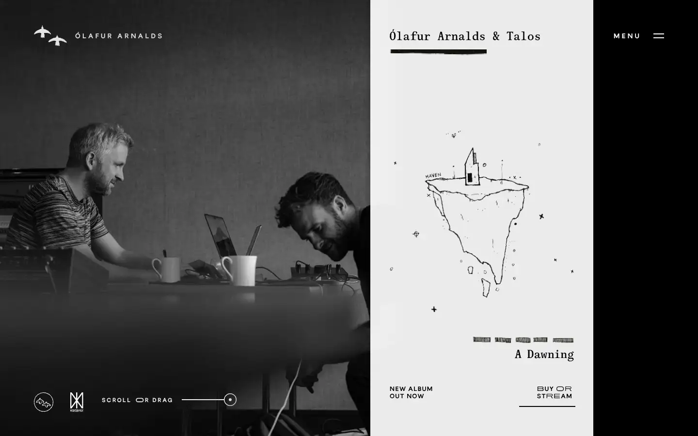
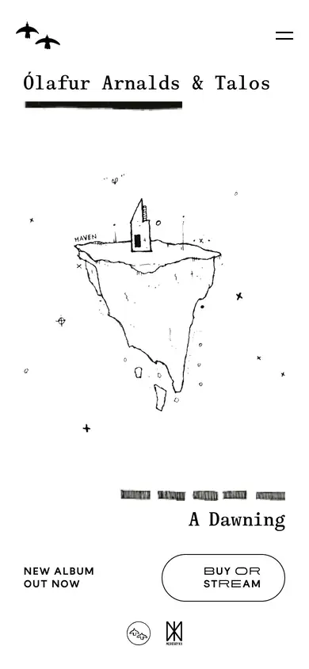

# olafur-arnalds

https://olafurarnalds.com
Tags: lorn, music, score
Picked because: Ólafur Arnalds: cinematic, atmospheric musician

## What makes it work
Split screen: a black-and-white photo beside a hand-drawn illustration and fine type.

## Good reference for
Release pages, split layouts.

## Lesson for RUIN-1
Pairing a photo with a delicate drawing adds intimacy.

## Measured (from the live page)
- First screen: light (average brightness 0.398)
- Background: #ffffff; palette by area: #ffffff, #000000 at 40%, #180d07; accent: #180d07
- Fonts: Bandein Sans Web
- Headline: Bandein Sans Web, 20px, weight 300, uppercase (“Ólafur Arnalds & Talos - A Dawning”)
- Section title: Bandein Sans Web, 100px, weight 500, uppercase, tracking -5px (“Works”)
- Body: Bandein Sans Web, 14px, weight 500, uppercase, tracking 1.4px (“Ólafur Arnalds feat. Bonobo some kind of peace – 2020”)
- Navigation: Bandein Sans Web, 14px, weight 700, uppercase, tracking 4.2px (“Ólafur Arnalds”)
- Buttons: none found
- Section spacing (median vertical padding): ?; page height 900px
- Phone: headline 16px, side margin 30px

## Screenshots
 

Whole page: [desktop](desktop-full.webp) · [phone](phone-full.webp)
