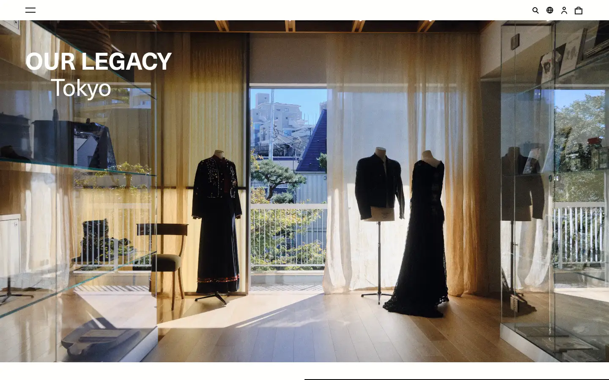
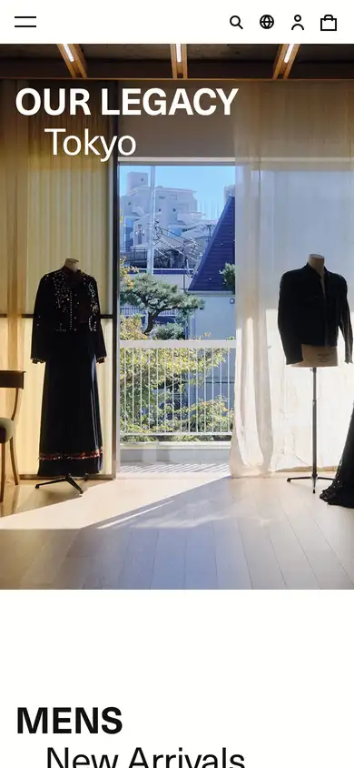

# our-legacy

https://www.ourlegacy.com
Tags: fashion, minimal
Picked because: Our Legacy: quiet, minimal fashion

## What makes it work
Big editorial photography with a bold caps location title, nearly no UI.

## Good reference for
Editorial image sections.

## Lesson for RUIN-1
Location or scene labels over images add story with two words.

## Measured (from the live page)
- First screen: light (average brightness 0.515)
- Background: #fffffc; palette by area: #fffffc, #121110, #ffffff; accent: none
- Fonts: sans-serif, Neue Haas Unica, Arial, Helvetica
- Headline: Neue Haas Unica, 56px, weight 700, uppercase, tracking -0.5616px (“OUR LEGACY”)
- Section title: Neue Haas Unica, 56px, weight 400, tracking -0.5616px (“Tokyo”)
- Body: Neue Haas Unica, 14px, weight 400 (“History is reinterpreted for today in denim: old-time washes”)
- Navigation: Neue Haas Unica, 14px, weight 700 (“Contact”)
- Buttons: “Skip to content” 47px tall, radius 0px, 13px 700 uppercase
- Section spacing (median vertical padding): ?; page height 12883px
- Phone: headline 40px, side margin 16px

## Screenshots
 

Whole page: [desktop](desktop-full.webp) · [phone](phone-full.webp)
