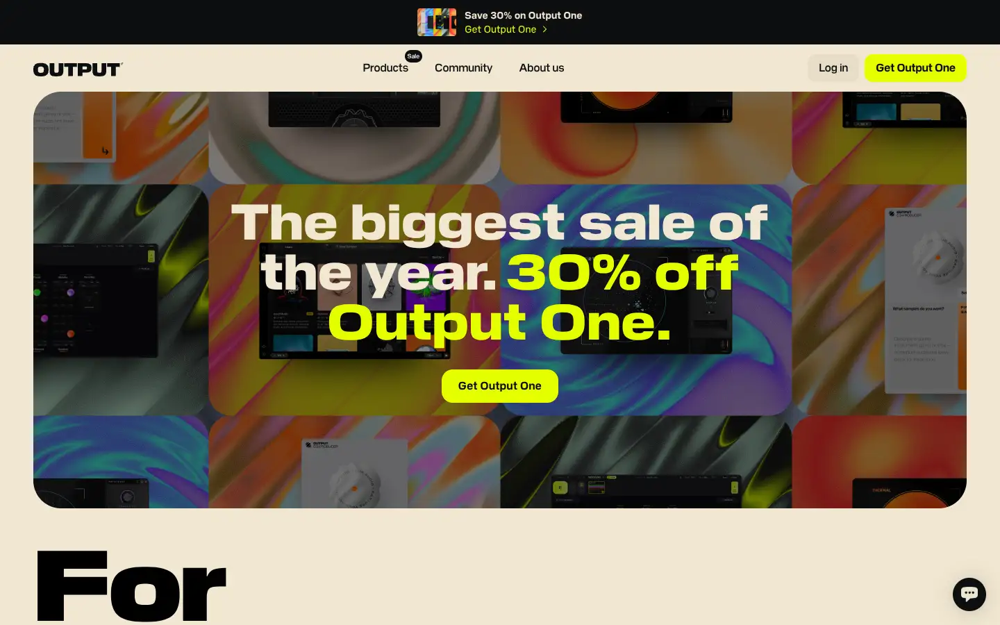
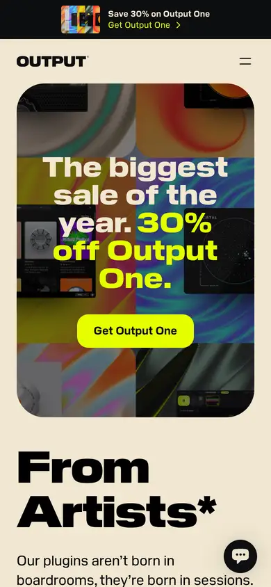

# output

https://output.com
Tags: music, product
Picked because: Output: popular plugin brand, as a contrast (what to beat)

## What makes it work
Loud colourful sale banner, big rounded type, many offers.

## Good reference for
A contrast: plugin-site norms.

## Lesson for RUIN-1
The bar we want to clear: no shouting, no sale clutter; let the sound and the dark do it.

## Measured (from the live page)
- First screen: light (average brightness 0.449)
- Background: #f1e7d1; palette by area: #0d0e0f at 5%, #0d0e0f, #000000 at 20%, #f1e7d1, #303236, #f1e7d1 at 60%; accent: #e5ff00 at 10%
- Fonts: Pilat Book, Pilat Bold, Pilat Demi, Pilat Heavy, Pilat Regular, Pilat Wide Heavy
- Headline: Pilat Wide Heavy, 72px, weight 400, tracking 1.44px (“The biggest sale of the year. 30% off Output One.”)
- Section title: Pilat Wide Black, 144px, weight 900 (“From”)
- Body: Pilat Bold, 14px, weight 400, tracking 0.4px (“Save 30% on Output One”)
- Navigation: Pilat Heavy, 24px, weight 400, tracking 0.6px (“Output One”)
- Buttons: “Save 30% on Output OneGet Outp” 40px tall, radius 0px, 16px 400 none, border 0px rgb(229, 231, 235); “Products Sale” 40px tall, radius 12px, 16px 400 none, border 0px rgb(229, 231, 235); “Output One” 40px tall, radius 0px, 24px 400 none, border 0px rgb(229, 231, 235); “Co-Producer” 40px tall, radius 0px, 24px 400 none, border 0px rgb(229, 231, 235)
- Section spacing (median vertical padding): ?; page height 7567px
- Phone: headline 40px, side margin 156px

## Screenshots
 

Whole page: [desktop](desktop-full.webp) · [phone](phone-full.webp)
