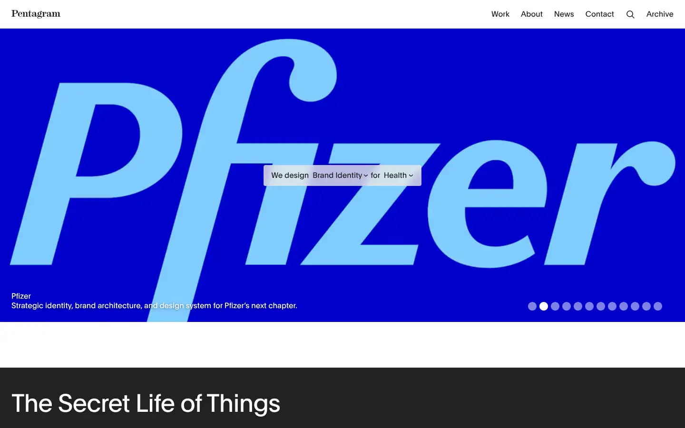
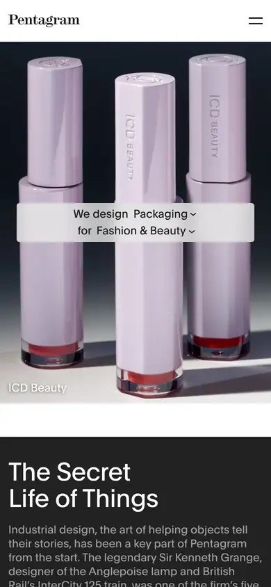

# pentagram

https://www.pentagram.com
Tags: studio, type-led
Picked because: Pentagram: the world's top design studio, typographic rigour

## What makes it work
Massive type and solid colour fields; the work at billboard scale.

## Good reference for
Portfolio and project grids.

## Lesson for RUIN-1
Scale and colour discipline: big work, tiny labels.

## Measured (from the live page)
- First screen: light (average brightness 0.387)
- Background: #ffffff; palette by area: #ffffff, #1a1a1a, #222222, #e3e4e5, #e3e4e5 at 65%, #ffffff at 70%; accent: none
- Fonts: Plain
- Headline: Plain, 19px, weight 500 (“Pentagram”)
- Section title: Plain, 16px, weight 500 (“Site navigation”)
- Body: Plain, 16px, weight 400 (“A new identity, bespoke typography and motion for Firaxis Ga”)
- Navigation: Plain, 19px, weight 500 (“Pentagram”)
- Buttons: “Work” 39px tall, radius 0px, 32px 400 none, border 0px rgb(255, 255, 255); “About” 39px tall, radius 0px, 32px 400 none, border 0px rgb(255, 255, 255); “News” 39px tall, radius 0px, 32px 400 none, border 0px rgb(255, 255, 255); “Contact” 39px tall, radius 0px, 32px 400 none, border 0px rgb(255, 255, 255)
- Section spacing (median vertical padding): 24px; page height 25620px
- Phone: headline 17px, side margin 12px

## Screenshots
 

Whole page: [desktop](desktop-full.webp) · [phone](phone-full.webp)
