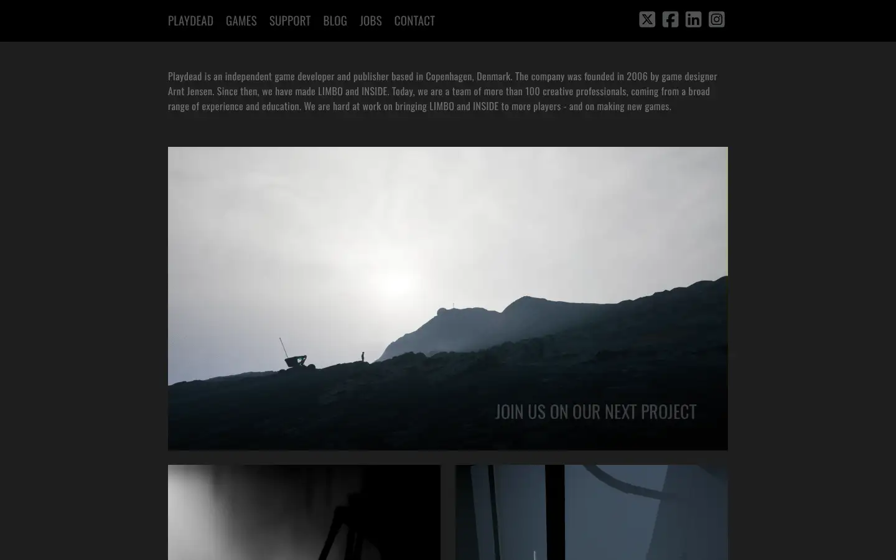

# playdead

https://playdead.com
Tags: lorn, games, dark, minimal
Picked because: Playdead (Limbo, Inside): stark, silent, atmospheric

## What makes it work
Near-monochrome greys, a small nav row, one silent landscape image.

## Good reference for
Minimal dark pages.

## Lesson for RUIN-1
Desaturated, quiet frames feel more dread-filled than loud ones.

## Measured (from the live page)
- First screen: dark (average brightness 0.26)
- Background: #1e1e1e; palette by area: #707070, #b4b9be, #414141, #515352, #ffffff, #101010; accent: none
- Fonts: Oswald, Font Awesome 7 Brands
- Headline: Oswald, 20px, weight 700, tracking 0.4px (“Sign up for updates:”)
- Section title: Oswald, 20px, weight 700, tracking 0.4px (“Sign up for updates:”)
- Body: not measured
- Navigation: Oswald, 19px, weight 400, uppercase, tracking 0.2px (“Support”)
- Buttons: none found
- Section spacing (median vertical padding): ?; page height 1623px
- Phone: headline ?, side margin 20px

## Screenshots
 

Whole page: [desktop](desktop-full.webp) · [phone](phone-full.webp)
