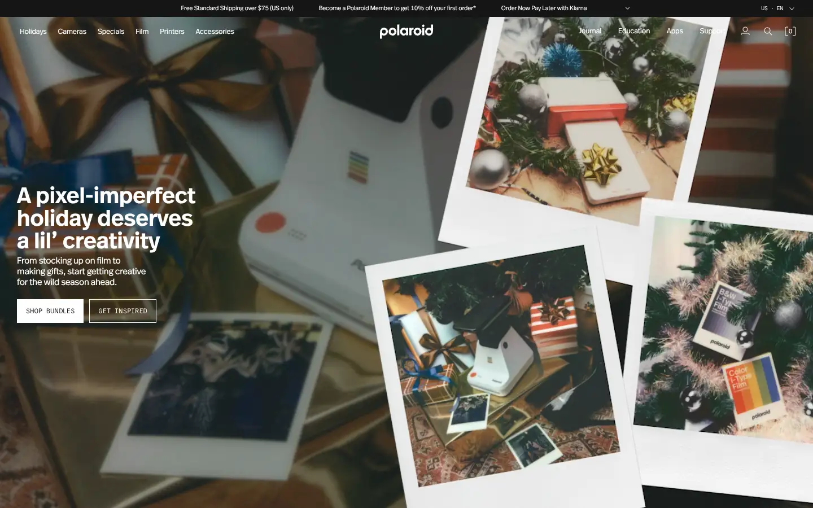
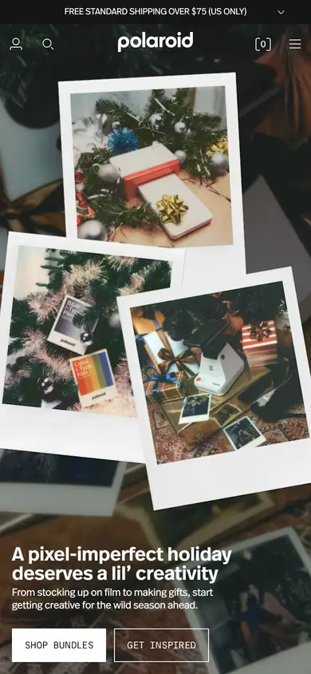

# polaroid

https://www.polaroid.com
Tags: lorn, analog, product
Picked because: Polaroid: analog/instant photography, worn charm

## What makes it work
Real photographs scattered like on a table; texture and warmth from the medium itself.

## Good reference for
Lifestyle and texture sections.

## Lesson for RUIN-1
Showing artefacts (prints, tape, notes) makes a digital product feel physical.

## Measured (from the live page)
- First screen: light (average brightness 0.396)
- Background: #ffffff; palette by area: #e9e9e9, #151515 at 30%, #ffffff, #151515 at 20%, #151515, #efefef; accent: #78be20
- Fonts: sans-serif, REAL_HEADER_OFFC_REGULAR, COMMIT_MONO, Times New Roman, REAL_HEADER_OFFC_DEMIBOLD
- Headline: REAL_HEADER_OFFC_DEMIBOLD, 40px, weight 600 (“A pixel-imperfect holiday deserves a lil’ creativity”)
- Section title: REAL_HEADER_OFFC_DEMIBOLD, 22px, weight 600, tracking -0.605px (“Change region”)
- Body: REAL_HEADER_OFFC_REGULAR, 16px, weight 400, tracking -0.32px (“From stocking up on film to making gifts, start getting crea”)
- Navigation: REAL_HEADER_OFFC_REGULAR, 13px, weight 400, tracking -0.2106px (“Holidays”)
- Buttons: “Confirm” 45px tall, radius 0px, 12px 400 uppercase; “Make it Creative” 33px tall, radius 0px, 12px 400 uppercase, border 1px rgb(21, 21, 21); “Make it their camera” 33px tall, radius 0px, 12px 400 uppercase, border 1px rgb(21, 21, 21); “A wild gift appears!” 33px tall, radius 0px, 12px 400 uppercase, border 1px rgb(21, 21, 21)
- Section spacing (median vertical padding): 150px; page height 6411px
- Phone: headline 24px, side margin 15px

## Screenshots
 

Whole page: [desktop](desktop-full.webp) · [phone](phone-full.webp)
