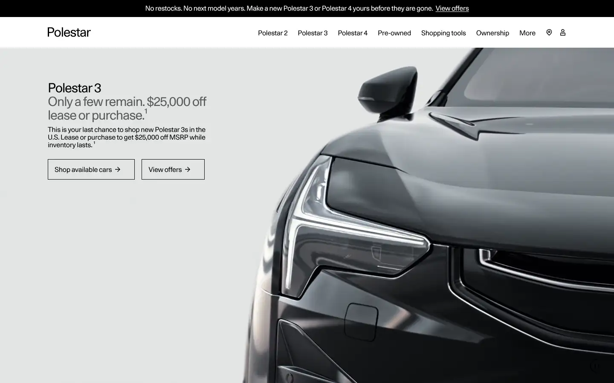
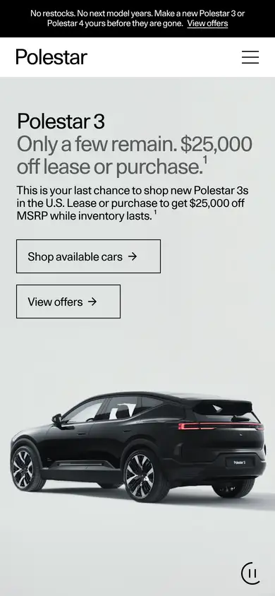

# polestar

https://www.polestar.com/us/
Tags: product, minimal, type-led
Picked because: Polestar: Scandinavian minimal, precise type

## What makes it work
Cold grey photography, precise small type, lots of space, a quiet two-button pair.

## Good reference for
Minimal, precise layouts.

## Lesson for RUIN-1
Precision (alignment, small type, grey) reads as engineering quality.

## Measured (from the live page)
- First screen: light (average brightness 0.615)
- Background: #ffffff; palette by area: #ffffff, #f0f0f0, #000000 at 60%, #0000ee, #3a3c3f, #ffffff at 60%; accent: #0000ee
- Fonts: Polestar Unica
- Headline: Polestar Unica, 30px, weight 400, tracking -1.2px (“Polestar 3”)
- Section title: Polestar Unica, 30px, weight 400, tracking -1.2px (“Only a few remain. $25,000 off lease or purchase.¹”)
- Body: Polestar Unica, 16px, weight 400, tracking -0.3px (“No restocks. No next model years. Make a new Polestar 3 or P”)
- Navigation: Polestar Unica, 16px, weight 400, tracking -0.3px (“Polestar”)
- Buttons: none found
- Section spacing (median vertical padding): 40px; page height 5307px
- Phone: headline 30px, side margin 23px

## Screenshots
 

Whole page: [desktop](desktop-full.webp) · [phone](phone-full.webp)
