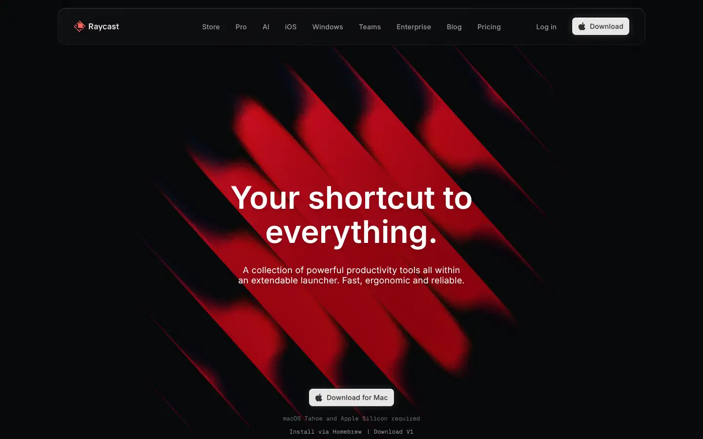
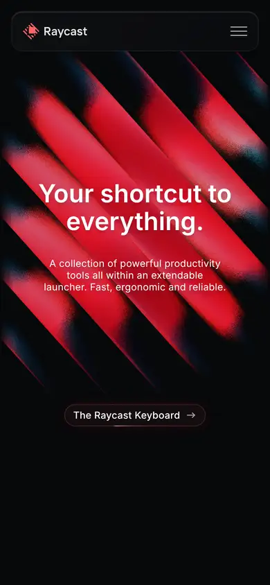

# raycast

https://www.raycast.com
Tags: software, dark
Picked because: Raycast: dark, glossy, crafted product site

## What makes it work
Abstract red light streaks on black behind a centred headline; glossy and premium.

## Good reference for
Dark abstract heroes.

## Lesson for RUIN-1
A red light effect behind the headline is close to our safelight; keep it abstract and soft.

## Measured (from the live page)
- First screen: dark (average brightness 0.088)
- Background: undefined; palette by area: ?; accent: none
- Fonts: ?
- Headline: not measured
- Section title: not measured
- Body: not measured
- Navigation: not measured
- Buttons: none found
- Section spacing (median vertical padding): ?; page height ?px
- Phone: headline ?, side margin ?px

## Screenshots
 

Whole page: [desktop](desktop-full.webp) · [phone](phone-full.webp)
