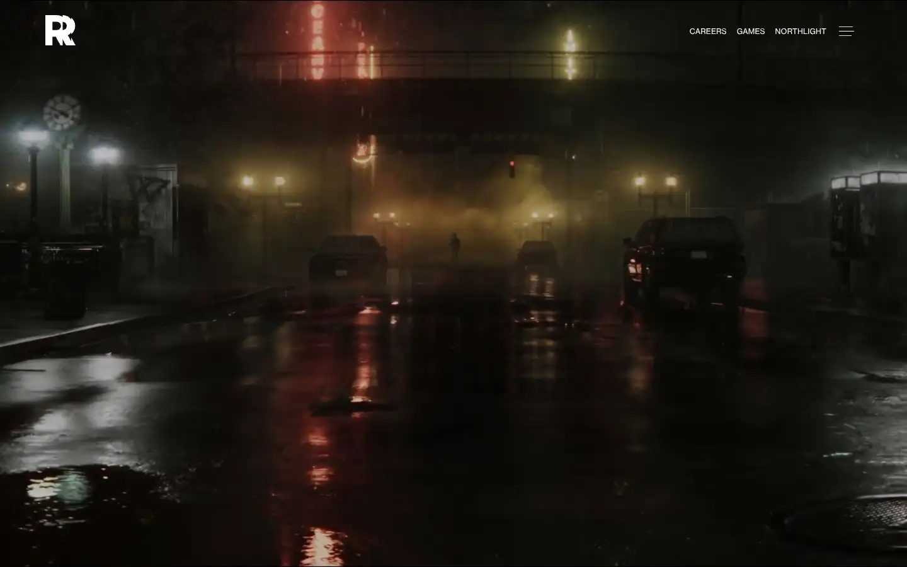
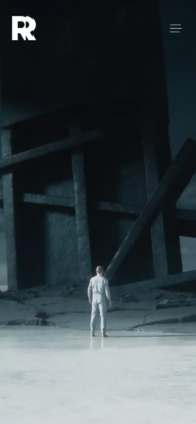

# remedy

https://www.remedygames.com
Tags: lorn, games, dark, hero
Picked because: Remedy: dark, atmospheric game studio

## What makes it work
A rainy, dim photograph with almost no UI; the brand mark small in a corner.

## Good reference for
Mood-first openers.

## Lesson for RUIN-1
Let the atmosphere load before anything asks for attention.

## Measured (from the live page)
- First screen: dark (average brightness 0.116)
- Background: #0056a7; palette by area: #000000 at 40%, #1d252d, #ffffff at 85%, #e8383b, #a4bcc2, #ffffff; accent: #1d252d
- Fonts: neue-haas-grotesk-text
- Headline: neue-haas-grotesk-text, 18px, weight 700, uppercase, tracking 0.36px (“Latest news”)
- Section title: neue-haas-grotesk-text, 18px, weight 700, uppercase, tracking 0.36px (“Latest news”)
- Body: neue-haas-grotesk-text, 48px, weight 400 (“Our mission is to create thrilling experiences you can’t fin”)
- Navigation: not measured
- Buttons: none found
- Section spacing (median vertical padding): 112px; page height 3934px
- Phone: headline ?, side margin 24px

## Screenshots
 

Whole page: [desktop](desktop-full.webp) · [phone](phone-full.webp)
