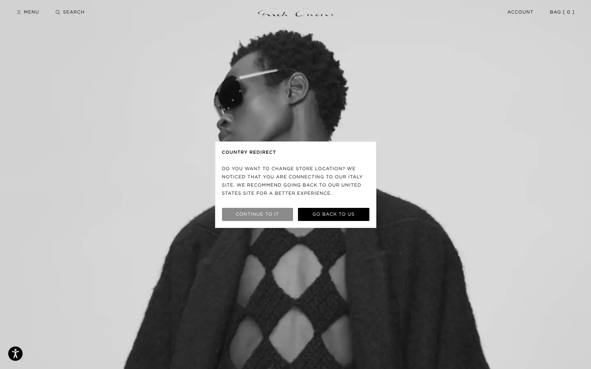
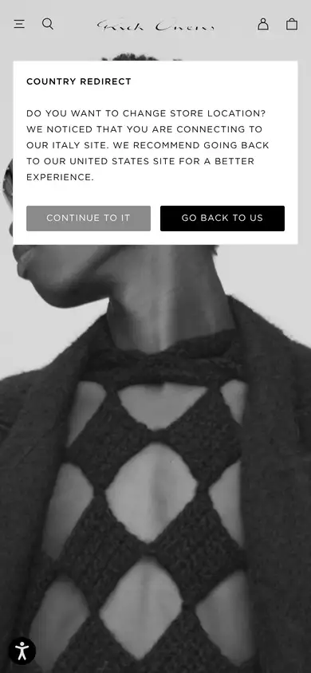

# rick-owens

https://www.rickowens.eu
Tags: lorn, fashion, dark, outlier
Picked because: Rick Owens: brutal, dark, raw luxury; strong mood

## What makes it work
Stark black and white, tiny caps everywhere, the product photographed brutally.

## Good reference for
Luxury, fashion-grade restraint.

## Lesson for RUIN-1
Tiny type and big imagery is how luxury says it doesn't need to shout.

## Measured (from the live page)
- First screen: light (average brightness 0.67)
- Background: #ffffff; palette by area: #ffffff, #000000 at 75%, #8a8a8a, #595959; accent: none
- Fonts: Gotham Book, Gotham Medium, -apple-system
- Headline: Gotham Medium, 11px, weight 400, uppercase, tracking 0.88px (“Country Redirect”)
- Section title: Gotham Medium, 11px, weight 400, uppercase, tracking 0.88px (“Country Redirect”)
- Body: Gotham Book, 11px, weight 400, uppercase, tracking 0.88px (“Home page”)
- Navigation: Gotham Book, 10px, weight 400 (“Logo Logo”)
- Buttons: “Continue to IT” 32px tall, radius 2px, 11px 400 uppercase, border 0px rgb(255, 255, 255); “Go back to US” 32px tall, radius 2px, 11px 400 uppercase, border 0px rgb(255, 255, 255)
- Section spacing (median vertical padding): ?; page height 3758px
- Phone: headline 10px, side margin 16px

## Screenshots
 

Whole page: [desktop](desktop-full.webp) · [phone](phone-full.webp)
