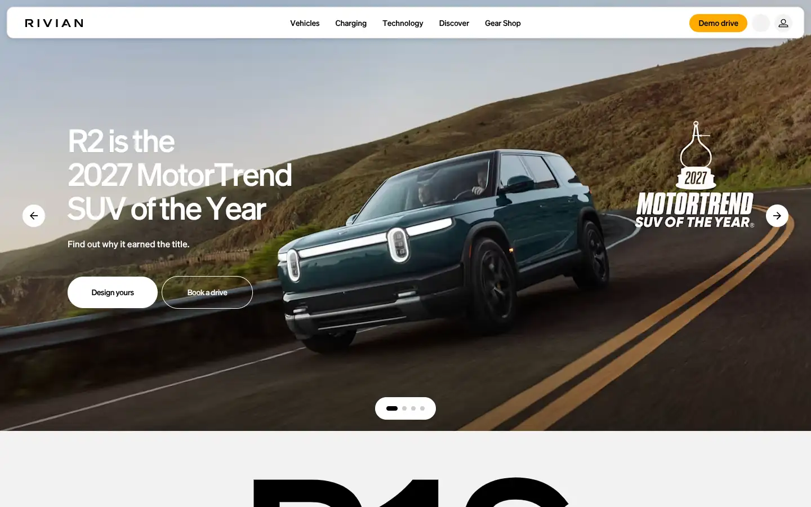
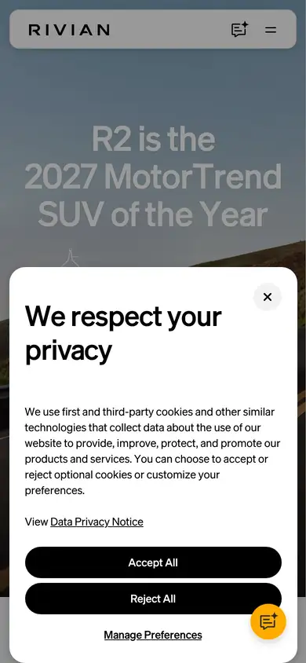

# rivian

https://rivian.com
Tags: product, hero
Picked because: Rivian: product story with strong imagery

## What makes it work
Big bold headline on an outdoor shot, a bright yellow accent button.

## Good reference for
Award and announcement heroes.

## Lesson for RUIN-1
One saturated accent button against natural imagery pops hard: our ember does the same.

## Measured (from the live page)
- First screen: light (average brightness 0.484)
- Background: #ffffff; palette by area: #f2f2f2, #9fa1b8, #212121, #ececec, #ffffff, #151515; accent: #629b5c
- Fonts: Adventure, Liga, Sohne
- Headline: Adventure, 72px, weight 600, tracking -3px (“Find your Rivian”)
- Section title: Adventure, 56px, weight 600, tracking -2.5px (“R2 is the2027 MotorTrendSUV of the Year”)
- Body: Adventure, 16px, weight 500 (“Find out why it earned the title.”)
- Navigation: Adventure, 14px, weight 600, tracking -0.14px (“Demo drive”)
- Buttons: “Skip To Main” 36px tall, radius 0px, 14px 400 uppercase, border 0px rgb(229, 231, 235); “Vehicles” 32px tall, radius 9999px, 14px 600 none, border 0px rgb(229, 231, 235); “Charging” 32px tall, radius 9999px, 14px 600 none, border 0px rgb(229, 231, 235); “Technology” 32px tall, radius 9999px, 14px 600 none, border 0px rgb(229, 231, 235)
- Section spacing (median vertical padding): 80px; page height 16941px
- Phone: headline ?, side margin ?px

## Screenshots
 

Whole page: [desktop](desktop-full.webp) · [phone](phone-full.webp)
