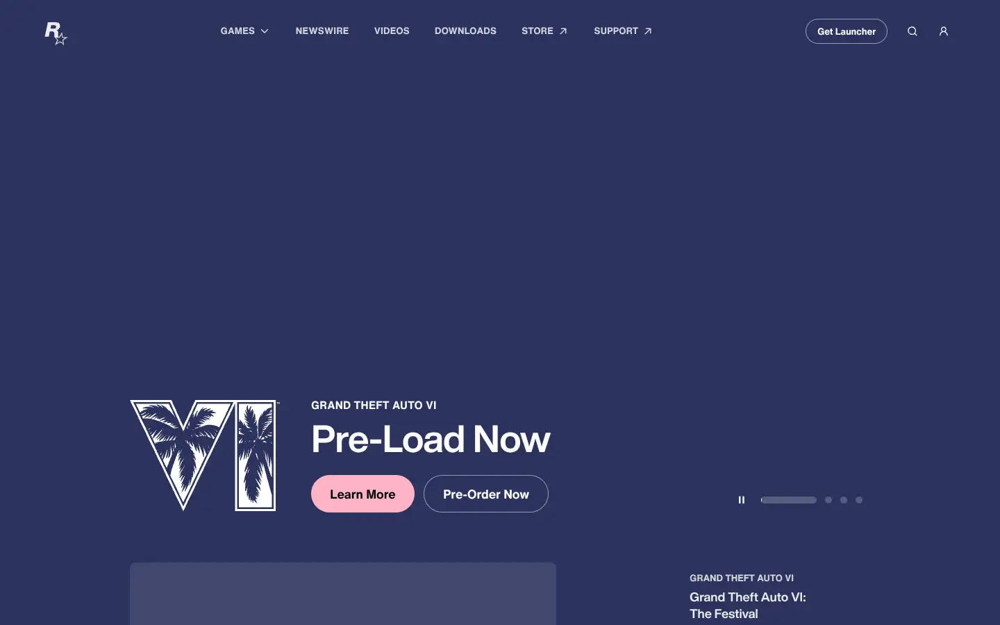
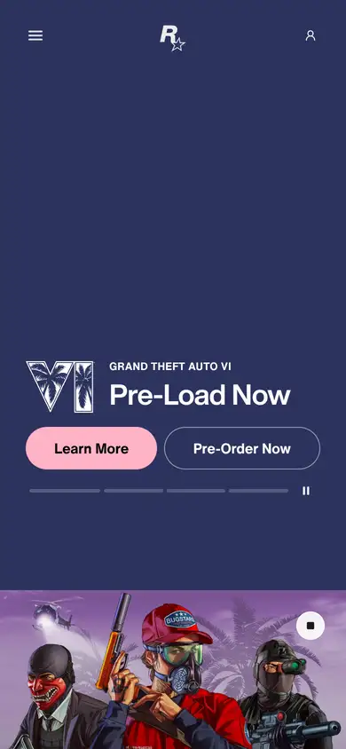

# rockstar

https://www.rockstargames.com
Tags: games, hero, cinematic
Picked because: Rockstar: cinematic game marketing

## What makes it work
Illustrated key art, big product title, two pill buttons and a pre-load call to action.

## Good reference for
Launch and pre-order heroes.

## Lesson for RUIN-1
Pre-order energy: one bold product logo, two clear actions.

## Measured (from the live page)
- First screen: dark (average brightness 0.231)
- Background: #ffffff; palette by area: #141414, #e8e8e8, #ffffff at 10%, #ffffff at 90%, #cecece, #ffffff; accent: none
- Fonts: HelveticaNowText, Helvetica Now Text, Helvetica Now Display, -apple-system
- Headline: Helvetica Now Display, 54px, weight 700, tracking -0.405px (“Pre-Load Now”)
- Section title: Helvetica Now Display, 54px, weight 700, tracking -0.405px (“Pre-Load Now”)
- Body: Helvetica Now Text, 16px, weight 700, uppercase, tracking 0.315px (“Grand Theft Auto VI”)
- Navigation: Helvetica Now Text, 14px, weight 700, uppercase, tracking 0.27px (“Newswire”)
- Buttons: “Get Launcher” 36px tall, radius 1000px, 14px 700 none, border 1px rgba(255, 255, 255, 0.5); “Learn More” 54px tall, radius 1000px, 18px 700 none; “Pre-Order Now” 54px tall, radius 1000px, 18px 700 none, border 1px rgba(255, 255, 255, 0.5); “Learn More” 54px tall, radius 1000px, 18px 700 none
- Section spacing (median vertical padding): 144px; page height 8119px
- Phone: headline ?, side margin 123px

## Screenshots
 

Whole page: [desktop](desktop-full.webp) · [phone](phone-full.webp)
