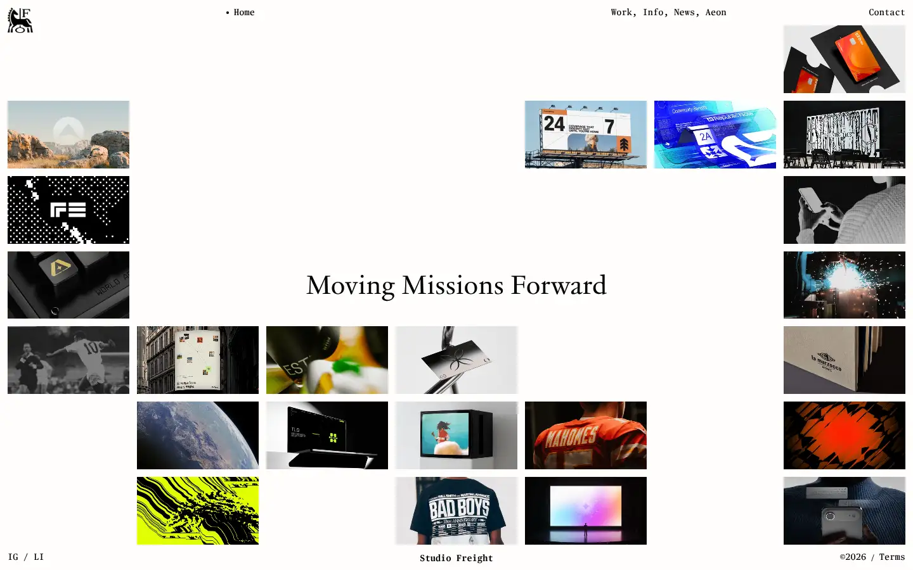
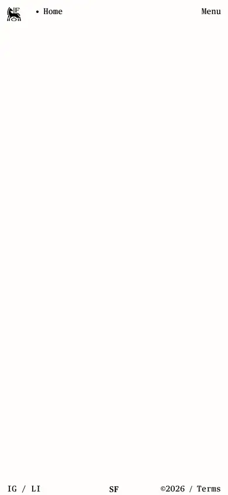

# studio-freight

https://studiofreight.com
Tags: studio, type-led, motion
Picked because: Studio Freight: bold type and scroll craft

## What makes it work
A scattered grid of work around a centred line, monospaced type, playful layout.

## Good reference for
Gallery and work grids.

## Lesson for RUIN-1
Breaking the grid on purpose shows confidence; use sparingly.

## Measured (from the live page)
- First screen: light (average brightness 0.765)
- Background: #fefdfc; palette by area: #fefdfc; accent: none
- Fonts: publico-text-mono-roman, Times New Roman, publico-text-mono-semibold, jjannon-regular
- Headline: jjannon-regular, 42px, weight 400 (“Moving Missions Forward”)
- Section title: not measured
- Body: publico-text-mono-roman, 14px, weight 400, capitalize, tracking 0.14px (“Home”)
- Navigation: publico-text-mono-roman, 14px, weight 400, tracking 0.14px (“Work”)
- Buttons: none found
- Section spacing (median vertical padding): 80px; page height 900px
- Phone: headline ?, side margin ?px

## Screenshots
 

Whole page: [desktop](desktop-full.webp) · [phone](phone-full.webp)
