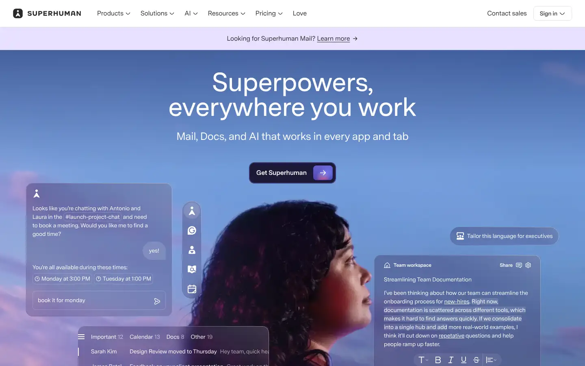
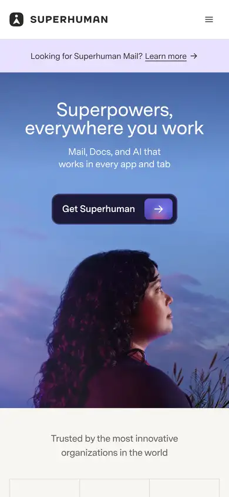

# superhuman

https://superhuman.com
Tags: software, dark, hero
Picked because: Superhuman: cinematic dark hero for software

## What makes it work
A dreamy gradient sky with a person and floating UI cards; soft, aspirational.

## Good reference for
Aspirational lifestyle heroes.

## Lesson for RUIN-1
Mostly a contrast: the opposite of RUIN-1's mood.

## Measured (from the live page)
- First screen: light (average brightness 0.532)
- Background: #ffffff; palette by area: #f7f5f2, #f2f0eb, #421d24, #281647, #e8e0ff, #dedbd5; accent: #421d24
- Fonts: Super Sans VF
- Headline: Super Sans VF, 64px, weight 440 (“Superpowers, everywhere you work”)
- Section title: Super Sans VF, 26px, weight 360 (“Mail, Docs, and AI that works in every app and tab”)
- Body: Super Sans VF, 16px, weight 360 (“Looking for Superhuman Mail?”)
- Navigation: Super Sans VF, 16px, weight 360 (“Love”)
- Buttons: “Get Superhuman” 50px tall, radius 12px, 16px 360 none, border 1px color(srgb 1 1 1 / 0.12); “Try Go” 52px tall, radius 12px, 16px 500 none; “Get Mail” 52px tall, radius 12px, 16px 500 none; “Try Docs” 52px tall, radius 12px, 16px 500 none
- Section spacing (median vertical padding): 192px; page height 7847px
- Phone: headline 32px, side margin 52px

## Screenshots
 

Whole page: [desktop](desktop-full.webp) · [phone](phone-full.webp)
