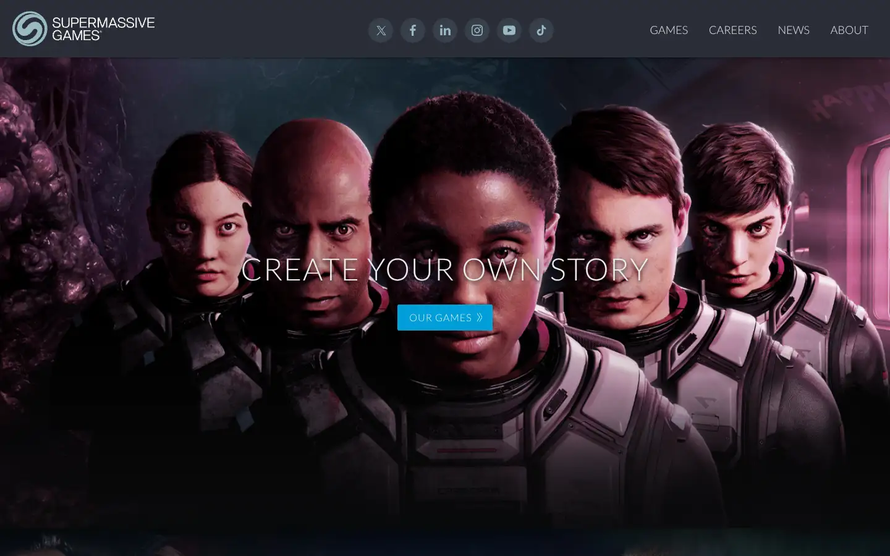
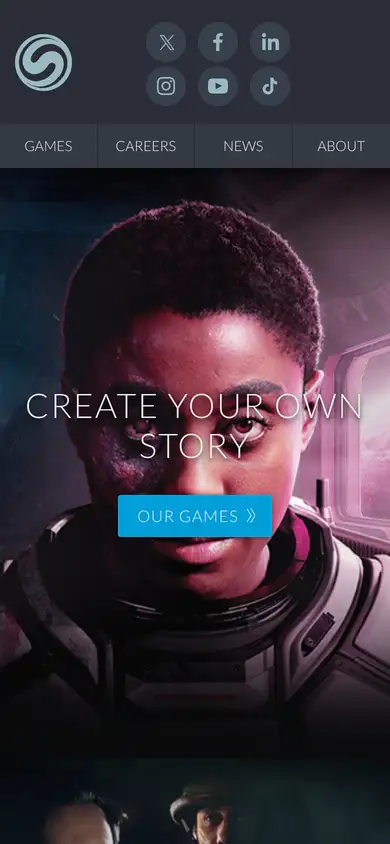

# supermassive

https://www.supermassivegames.com
Tags: lorn, games, dark
Picked because: Supermassive: horror games, moody presentation

## What makes it work
Dark cinematic key art with centred, thin, widely tracked caps over it.

## Good reference for
Game-style key art heroes.

## Lesson for RUIN-1
Thin wide caps over dark art is close to our current hero; keep it but cut the clutter.

## Measured (from the live page)
- First screen: dark (average brightness 0.157)
- Background: #1c1f25; palette by area: #1f2226, #25272a, #1c1f25, #292d36, #c5c7ca, #e9ebee; accent: #019ed8
- Fonts: Arial, Lato
- Headline: Lato, 50px, weight 300, uppercase, tracking 1.5px (“Create your own story”)
- Section title: Lato, 24px, weight 700, uppercase, tracking 1px (“Little Nightmares III DLC out now”)
- Body: Lato, 20px, weight 400 (“Twitter”)
- Navigation: Lato, 20px, weight 400 (“Twitter”)
- Buttons: “Our games” 42px tall, radius 2.5px, 16px 400 uppercase, border 1px rgb(6, 174, 236); “Our games” 42px tall, radius 2.5px, 16px 400 uppercase, border 1px rgb(53, 56, 57); “News Archive” 42px tall, radius 2.5px, 16px 400 uppercase, border 1px rgb(53, 56, 57); “Full Details” 42px tall, radius 2.5px, 16px 400 uppercase, border 1px rgb(53, 56, 57)
- Section spacing (median vertical padding): 160px; page height 2780px
- Phone: headline 34px, side margin 15px

## Screenshots
 

Whole page: [desktop](desktop-full.webp) · [phone](phone-full.webp)
