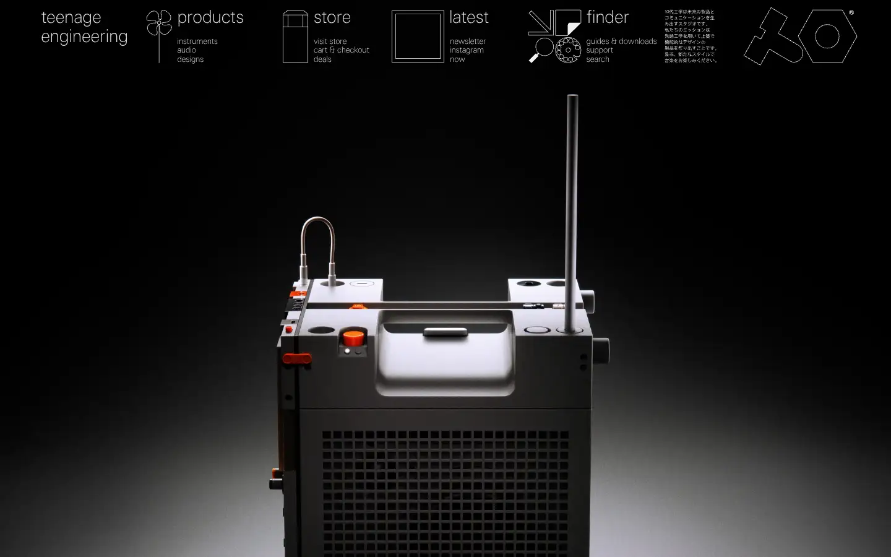
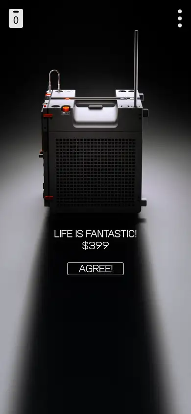

# teenage-engineering

https://teenage.engineering
Tags: product, hardware, music, dark, type-led
Picked because: Teenage Engineering: instruments as objects, dramatic lighting

## What makes it work
A single object in dramatic top light on black; thin, light type set very small; a playful icon nav.

## Good reference for
Instrument heroes, catalogue nav.

## Lesson for RUIN-1
Dramatic top light plus tiny type is the closest product-photo match to RUIN-1's mood.

## Measured (from the live page)
- First screen: dark (average brightness 0.108)
- Background: #ffffff; palette by area: #f1f2f2, #e5e5e5, #f1f2f2 at 64%, #ffffff; accent: none
- Fonts: te-20, TechnoType
- Headline: not measured
- Section title: not measured
- Body: te-20, 19px, weight 100 (“newsletter”)
- Navigation: te-20, 16px, weight 100 (“teenage engineering”)
- Buttons: none found
- Section spacing (median vertical padding): 132px; page height 5856px
- Phone: headline ?, side margin 18px

## Screenshots
 

Whole page: [desktop](desktop-full.webp) · [phone](phone-full.webp)
