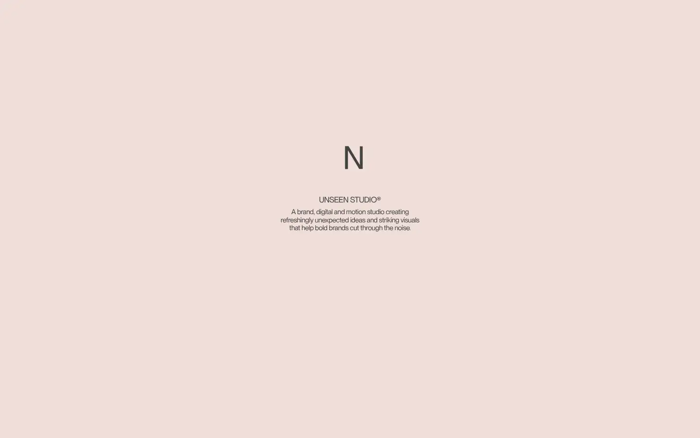
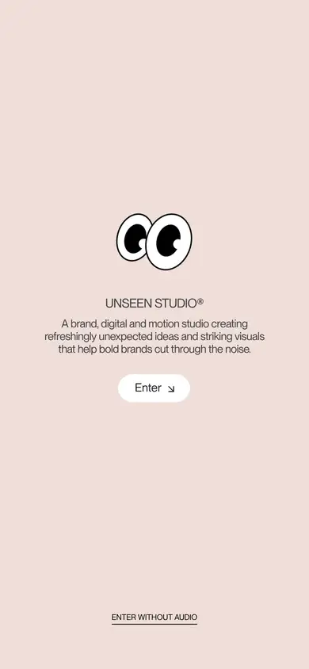

# unseen

https://unseen.co
Tags: studio, motion, dark
Picked because: Unseen Studio: atmospheric, motion-led

## What makes it work
Pale, soft gradient with one tiny centred mark and a short line; it waits for you to scroll.

## Good reference for
Soft openers and loaders.

## Lesson for RUIN-1
A calm loading moment can set the mood before the page reveals.

## Measured (from the live page)
- First screen: light (average brightness 0.888)
- Background: #212121; palette by area: #ffffff, #212121, #efded9, #f1edeb, #424242, #d6d6d6; accent: none
- Fonts: Neue Montreal, Saol Display
- Headline: Neue Montreal, 29px, weight 700 (“Home”)
- Section title: not measured
- Body: Neue Montreal, 14px, weight 400, tracking -0.36px (“A brand, digital and motion studio creatingrefreshingly unex”)
- Navigation: Neue Montreal, 14px, weight 400 (“Index Index”)
- Buttons: none found
- Section spacing (median vertical padding): ?; page height 900px
- Phone: headline 28px, side margin 56px

## Screenshots
 

Whole page: [desktop](desktop-full.webp) · [phone](phone-full.webp)
