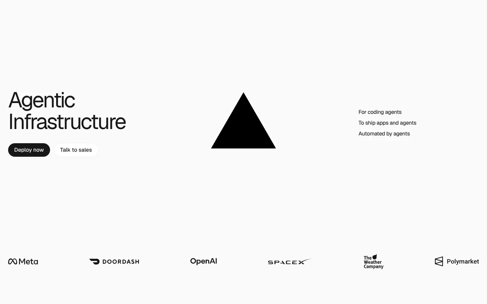
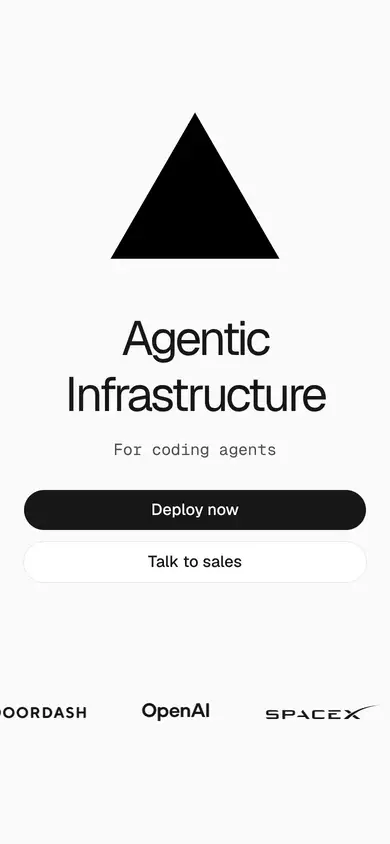

# vercel

https://vercel.com
Tags: software, dark, type-led
Picked because: Vercel: dark, grid-precise developer brand

## What makes it work
A single geometric shape, tight large type and a logo strip: ultra-minimal.

## Good reference for
Minimal heroes, trust logos.

## Lesson for RUIN-1
A row of partner/press logos is a cheap trust signal we lack.

## Measured (from the live page)
- First screen: light (average brightness 0.956)
- Background: #fafafa; palette by area: #010000 at 50%, #fafafa, #171717, #4d4d4d, #ffffff, #010000 at 80%; accent: #010000 at 50%
- Fonts: GeistSans, Geist Mono
- Headline: GeistSans, 64px, weight 400, tracking -3.84px (“Agentic Infrastructure”)
- Section title: GeistSans, 56px, weight 450, tracking -3.36px (“Build agents on infrastructure that thinks like them”)
- Body: GeistSans, 24px, weight 450, tracking -0.96px (“Notion powers millions of agent conversations daily on Verce”)
- Navigation: GeistSans, 16px, weight 500 (“Deploy now”)
- Buttons: “Deploy now” 40px tall, radius 3.35544e+07px, 16px 500 none, border 0px rgb(235, 235, 235); “Talk to sales” 40px tall, radius 3.35544e+07px, 16px 500 none, border 0px rgb(235, 235, 235); “Deploy now” 40px tall, radius 3.35544e+07px, 16px 500 none, border 0px rgb(235, 235, 235); “Onboard your agentPaste to you” 40px tall, radius 3.35544e+07px, 16px 500 none, border 0px rgb(235, 235, 235)
- Section spacing (median vertical padding): ?; page height 5866px
- Phone: headline 48px, side margin 24px

## Screenshots
 

Whole page: [desktop](desktop-full.webp) · [phone](phone-full.webp)
