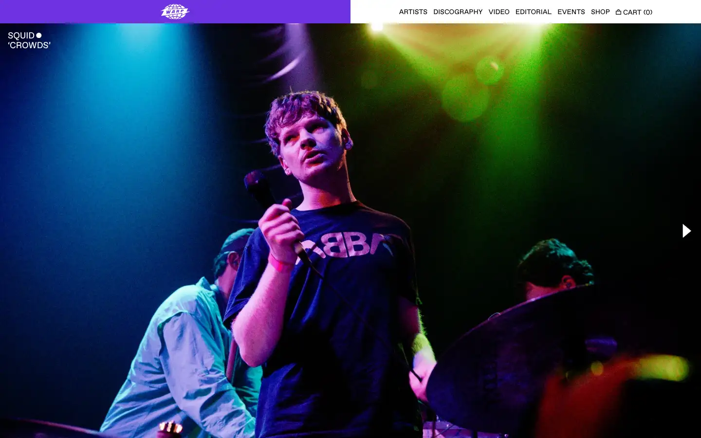
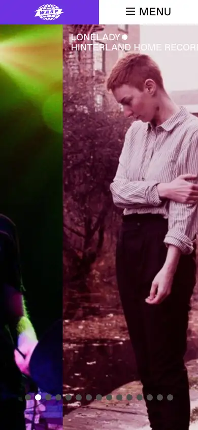

# warp

https://warp.net
Tags: lorn, music, label, type-led
Picked because: Warp: restrained, type-led presentation of experimental electronic music

## What makes it work
Full-bleed live photography with harsh coloured light; a thin nav bar and almost no type on top.

## Good reference for
Atmospheric heroes, artist sections.

## Lesson for RUIN-1
Coloured light on black is the mood; one strong image beats several weak ones.

## Measured (from the live page)
- First screen: dark (average brightness 0.185)
- Background: #373641; palette by area: #373641, #ffffff, #6e32e1; accent: #6e32e1
- Fonts: ABCFavorit
- Headline: ABCFavorit, 18px, weight 400, uppercase (“Squid ˇ”)
- Section title: ABCFavorit, 18px, weight 400, uppercase (“Squid ˇ”)
- Body: ABCFavorit, 18px, weight 400, uppercase (“‘CROWDS’”)
- Navigation: ABCFavorit, 14px, weight 400, uppercase (“Artists”)
- Buttons: none found
- Section spacing (median vertical padding): ?; page height 965px
- Phone: headline ?, side margin -374px

## Screenshots
 

Whole page: [desktop](desktop-full.webp) · [phone](phone-full.webp)
